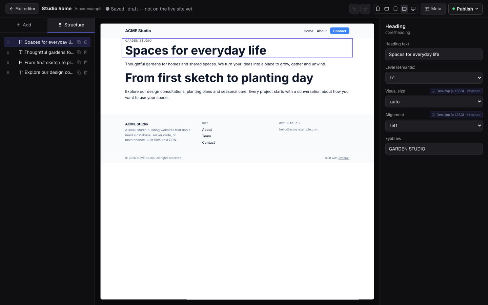

# Typeroll CMS

**The open-source CMS for AI agents.** Build and edit websites with Claude,
ChatGPT, Cursor or Codex over MCP, let clients edit in a visual editor, and
publish fast static Astro sites to your own Cloudflare or GitHub account.

[](LICENSE)
[](https://www.npmjs.com/package/@typeroll/mcp-server)

[Website](https://typeroll.com) · [Documentation](https://typeroll.com/docs/) ·
[Connect your agent](https://typeroll.com/docs/getting-started/connect-your-agent/) ·
[Docs for agents (llms.txt)](https://typeroll.com/docs/llms.txt)



## Try it in 60 seconds

Connect your agent to Typeroll Cloud (a 30-day trial, no card) and ask it to
build a site. In Claude Code:

```sh
claude mcp add --transport http typeroll https://app.typeroll.com/api/mcp
```

Then run `/mcp`, sign in, and ask: *"Create a website for my studio with a home,
services and contact page, then show me a preview."* Setup for Claude,
ChatGPT, Cursor, VS Code and Codex is on the
[connection page](https://typeroll.com/docs/getting-started/connect-your-agent/).
The [build with Claude Code](https://typeroll.com/docs/guides/build-with-claude-code/)
guide walks through a full site, from the first page to a custom domain.

## Why Typeroll

- **Agent-first.** 260 MCP tools and step-by-step recipes (skills) for new
  sites, WordPress and Astro migrations, branding, SEO and launch checks.
- **Clients can edit.** A visual block editor with drafts, previews and owner
  review, so non-technical editors never touch code.
- **Static and yours.** Sites compile to static Astro output and publish to
  your own Cloudflare or GitHub account. No lock-in; export at any time.
- **SEO and AI search built in.** Sitemaps, hreflang, structured data,
  `llms.txt`, per-page Markdown, an AI crawler policy and a launch readiness
  report on every site.
- **Open source.** Self-host it, or use Typeroll Cloud for unlimited sites and
  users.

Freelancers and web agencies use Typeroll to build and manage client websites
with their own AI agents and give clients access to edit content in the
browser. Organizations use it to manage their own websites.

The repository contains the editor, public API, MCP server, Forms backend,
Extension runtime, static renderer, and self-hosting adapters as open-source
software. Most code is MIT-licensed; the WordPress helper plugin is
GPL-2.0-or-later for WordPress compatibility.

AI agents can connect through MCP using a supported HTTP or stdio client, or
call the REST API directly. See [client compatibility and verification status](packages/docs-site/src/content/docs/getting-started/client-compatibility.mdx)
and the [connection guide](packages/docs-site/src/content/docs/getting-started/mcp-server.mdx).

## What is included

- block and HTML page editing with live preview;
- Pages with content types, reusable blocks, media, redirects, templates, and workflows;
- server-backed Forms with stored submissions, email actions, and webhooks;
- the Extension manifest, installation, admin SSO, and browser runtime;
- the WordPress migration workflow, URL coverage tools, and helper plugin;
- a REST API and `@typeroll/mcp-server` for agent-driven site management;
- static site generation and Cloudflare Pages deployment support;
- Firebase/Firestore, R2, and local fixture-store adapters.

Forms is a core module in both the open-source edition and Typeroll Cloud. A
self-hosted installation stores submissions in its own datastore and sends
notifications and webhooks through services configured by its operator.

## Repository layout

```text
packages/shared/         Shared data contracts and block renderer
packages/site-template/  Astro static site generator
packages/portal/         Astro/React CMS, API, Forms, and Extension runtime
packages/mcp-server/     Public MCP server and CLI
packages/docs-site/      Public documentation
wp-helper-plugin/         Read-only WordPress migration helper
examples/                Extension examples
```

## Run the CMS locally

To build or migrate **your own website** with an AI agent, start from the public
[site-starter template](https://github.com/Typeroll/site-starter) and follow the
[workspace setup guide](https://typeroll.com/docs/getting-started/agent-workspace/).
It includes a guided interview, project briefs, owner rules and SEO planning.
The commands below instead run the CMS itself for development.

Use Node.js 22 or later.

```sh
npm install
npm run dev:portal
```

The development server uses the fixture datastore and a local development
identity when Firebase is not configured. Open `http://localhost:4321`.

Run the static renderer separately with:

```sh
npm run dev:site
```

Before contributing, run:

```sh
node scripts/oss-release-check.mjs
```

Maintainer releases use one ordered train after successful CI on public
`main`: immutable Core image and tag, MCP package and tag, public docs, then a
Cloud-consumable release manifest. See [docs/releasing.md](docs/releasing.md).

See the [self-hosting guide](https://typeroll.com/docs/guides/self-hosting/)
for production configuration.

The supported production reference profile is fully serverless in a
customer-owned GCP/Firebase project: Cloud Run hosts portal and Forms, Cloud
Tasks invokes deploy work, and Cloud Scheduler invokes publish sweeps. It uses
one immutable Core image digest and Application Default Credentials, with no
VM, service-account key, or always-running worker. Start with
`config/self-host-gcp.example.json`, then run `npm run self-host:gcp:plan` and
the dry-run-first `npm run self-host:gcp:apply`. The read-only
`npm run self-host:gcp:doctor` verifies the control plane without reading
secret values. `compose.yaml` remains a portable fallback, not the supported
production profile. See the self-hosting guide before changing remote
resources.

## Cloud and premium products

Typeroll Cloud is the managed distribution operated from the private
`Typeroll/typeroll-cloud` repository. Its deployment automation, operator
console, marketing site, and operational configuration are not part of this
repository. The migration code is open source; Typeroll Cloud can provide its
execution, infrastructure, and support as a managed service.

Typeroll Apps are separately operated premium applications. They connect to
either Typeroll Cloud or a self-hosted installation through the same open
Extension protocol. Third-party Extensions remain hosted in their developers'
own accounts.

## Security

Report vulnerabilities privately as described in [SECURITY.md](SECURITY.md).
Do not open a public issue for an undisclosed vulnerability.

## License

Most of the repository is [MIT-licensed](LICENSE). The WordPress helper plugin
is distributed under
[GPL-2.0-or-later](wp-helper-plugin/LICENSE).
